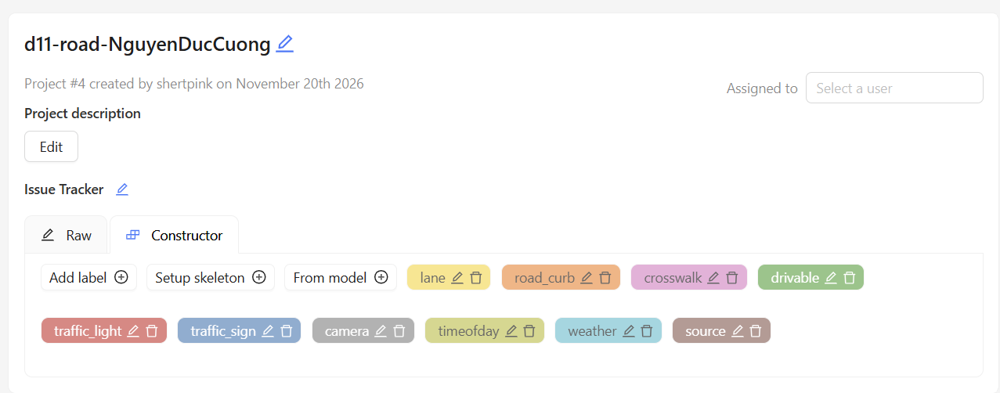
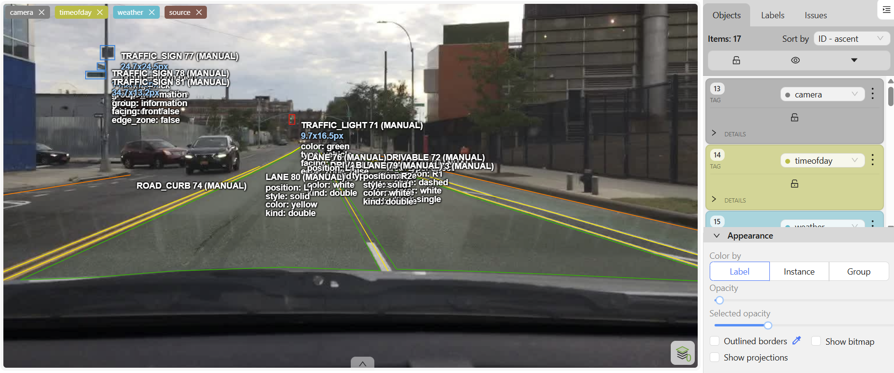
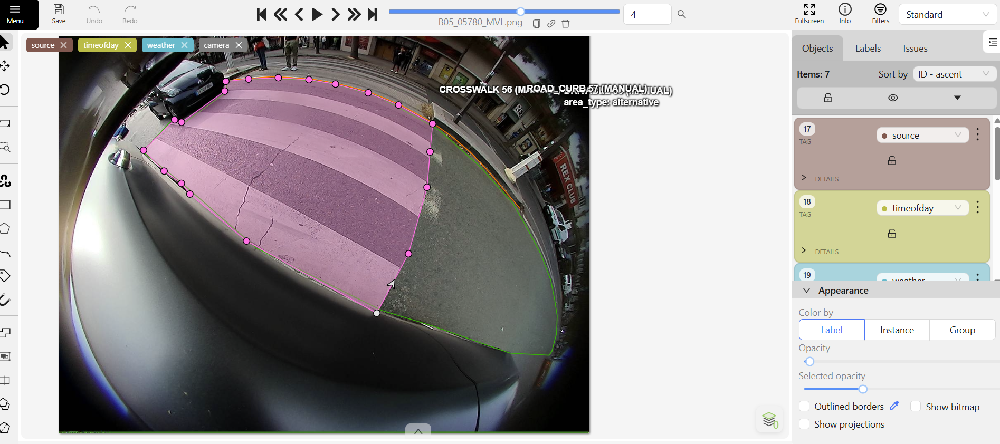

# Báo cáo cá nhân — Ngày 11
Họ tên: Nguyễn Đức Cường    Mã học viên: 03040  
Phiên bản CVAT (Help → About):  
Guideline: Road v1.0    Lần nộp (`revision` trong manifest): 1  
Thời điểm export (ngày giờ trên CVAT): front 21/11/2026 11:18, fisheye 21/11/2026 11:31 (giờ VN; `dumped` trong XML là 04:18 và 04:31 UTC)    Số lần nộp lại sau Rework: 0  

## 1. Kiểm project
| Mục | Đúng như guideline Road v1.0? | Ghi chú |
| --- | --- | --- |
| 6 label, đúng kiểu | Có | lane, road_curb: polyline · crosswalk, drivable: polygon · traffic_light, traffic_sign: rectangle (đọc từ `<meta>` của file export) |
| Thuộc tính và giá trị | Có | Trùng `configs/road_v1_labels.json`: lane position/style/color/kind, drivable area_type, đèn color/type/facing/edge_zone, biển group/facing/edge_zone; lint không báo QC1-12 |
| 4 tag ảnh | Có | camera, timeofday, weather, source: label kiểu Tag, mỗi label một thuộc tính select `value`; 20/20 ảnh đủ bốn tag (`images_all_tags` trong manifest) |

Cách kết thúc polyline trên bản CVAT này:  
Cách đặt tag ảnh trên bản CVAT này: chọn công cụ Tag ở thanh bên trái, chọn label (camera, timeofday, weather, source), rồi mở Details trong bảng Objects để chọn `value`. Mỗi ảnh một tag cho mỗi label, camera đặt trước tiên.

## 2. Số lượng đã gán
| Task | Ảnh | lane | road_curb | crosswalk | drivable | traffic_light | traffic_sign |
| --- | ---: | ---: | ---: | ---: | ---: | ---: | ---: |
| front | 12 | 33 | 14 | 3 | 26 | 22 | 23 |
| front-extra (đã làm 0 / 4) | 0 | — | — | — | — | — | — |
| fisheye | 8 | 6 | 10 | 7 | 3 | 5 | 2 |
| fisheye-extra (đã làm 0 / 4) | 0 | — | — | — | — | — | — |

## 3. Bảng ca khó
| Ảnh | Nhãn | Phân vân giữa | Đã chọn | Lý do |
| --- | --- | --- | --- | --- |
| A05 | lane L1/R1 |  |  |  |
| A06 | L1, R1 |  |  |  |
| A07 | L1 |  |  |  |
| A09 | R1 |  |  |  |

## 4. Phiếu QC 1 nhận được
Bạn kiểm lô của tôi: phammanhhung  Quyết định nhận được: **Rework** (lỗi nặng 0; lỗi chính 5 / 81 nhãn = 6,17 % > 5 %; lỗi nhẹ 1; ca chờ lead 1)  
| Mã lỗi | Số lỗi | Đồng ý? | Đã sửa? |
| --- | ---: | --- | --- |
| QC1-04 (A01 lane L2 vẽ từ xa về gần) | 1 |  |  |
| QC1-05 (A04 R2 vạch đôi tách 2 polyline; A04 hai polyline cùng L1; A08 L1 tách 2 đoạn) | 3 |  |  |
| QC1-07 (B06 thiếu polygon drivable) | 1 |  |  |
| Lỗi nhẹ (A04 box biển phụ thấp hơn 8 px) | 1 |  |  |

Ca mơ hồ trong phiếu: A07 không có L1 (lề trái không có vạch sơn). Lead trả lời: được miễn QC1-02 nếu thực tế ảnh không thấy vạch.  
Lần nộp mới sau khi sửa: revision __ (bản cũ cất ở `r1/`).

## 5. Kiểm file export
| File | Mở lại được? | Số shape ảnh 1 (job / file) | Số shape ảnh 2 (job / file) | Tag camera có trong XML? |
| --- | --- | --- | --- | --- |
| nguyenduccuong-front.zip | Có (`road_check lint`: 12 ảnh, `contains_images = false`) | A01: __ / 9 | A02: __ / 6 | Có (`camera = front` cả 12 ảnh) |
| nguyenduccuong-fisheye.zip | Có (`road_check lint`: 8 ảnh, `contains_images = false`) | B01: __ / 5 | B02: __ / 8 | Có (fisheye_front/rear/left/right đúng hậu tố FV/RV/MVL/MVR) |

## 6. Ảnh chụp màn hình
1. Tab Labels của project.

   

2. Một ảnh camera trước đã gán đủ (làn, vùng lái, đèn/biển).

   

3. Một ảnh fisheye đã gán, phóng to đoạn polyline cong.

   

4. Một đoạn XML có `<polyline label="lane">` (ảnh A01, trích `annotations.xml` trong `nguyenduccuong-front.zip`):

```xml
<polyline label="lane" source="manual" occluded="0" points="113.77,716.48;320.10,539.96;366.60,505.69" z_order="0">
  <attribute name="position">L1</attribute>
  <attribute name="style">dashed</attribute>
  <attribute name="color">white</attribute>
  <attribute name="kind">single</attribute>
</polyline>
```

## 7. Tự đánh giá
Lỗi bạn mắc nhiều nhất hôm nay (theo mã QC1-xx), và cách tránh ở Ngày 20:  
Nhãn của bạn đi vào model ở đâu? Chọn một lỗi đã sửa và nói nó làm model học sai thế nào:  

## 8. (Tùy chọn, buffer) Từ polyline đến đích row-anchor
Ảnh A01, vạch R1. Số liệu tính bằng `road_lab.rowanchor`, nội suy tuyến tính giữa hai điểm kẹp hàng y.

| y | 720 | 680 | 640 | 600 | 560 |
| --- | ---: | ---: | ---: | ---: | ---: |
| x của chúng tôi | không có làn | 644.1 | 590.3 | 536.4 | 482.6 |
| x của bạn kia (phammanhhung) | 707.1 | 652.2 | 597.4 | 542.5 | 487.0 |

Trả lời 3 câu:

1. Năm số x đó chính là đích mà một model row-anchor học cho vạch này. Nếu bạn dừng polyline sớm 40 px, hàng nào đổi thành "không có làn"?  
   R1 của tôi đi từ y = 719,8 lên tới y = 504,8. Dừng sớm 40 px thì điểm cuối ở khoảng y = 545, vẫn cao hơn hàng 560, nên cả năm hàng trong bảng **không đổi**. Chỉ các hàng nằm trong khoảng 505–545 mới mất đích. Ngược lại, hàng 720 hiện đã là "không có làn" vì điểm đầu chỉ ở y = 719,8: thiếu 0,2 px ở đáy ảnh cũng đủ làm mất đích ở hàng gần xe nhất.
2. So với bạn được kiểm (cùng ảnh): ở hàng 720 và hàng 560, hai bạn lệch nhau bao nhiêu pixel? Lệch ở hàng nào ảnh hưởng LKA nhiều hơn (slide 25)?  
   Hàng 720 không so được: polyline của tôi không chạm hàng này, còn bạn kia ở x = 707,1. Ở hàng 680 (hàng gần nhất so được), hai bạn lệch 8,1 px; ở hàng 560 lệch 4,4 px. Lệch ở hàng gần xe (720/680) ảnh hưởng LKA nhiều hơn, vì các hàng này quyết định vị trí ngang của xe so với vạch ngay trước mũi xe, chỗ hệ thống phải giữ làn. Đây cũng là lý do guideline yêu cầu điểm đầu sát xe đặt chính xác nhất.
3. Nếu polyline vẽ từ xa về gần (ngược quy tắc 2), cách tính trên có đổi không? Script nào sẽ gặp khó?  
   Giá trị x không đổi: hàm `x_at_y` chỉ tìm đoạn thẳng kẹp hàng y, không phụ thuộc thứ tự điểm. Script gặp khó là những script coi điểm đầu là điểm gần xe: `road_check` báo QC1-04 (vẽ ngược chiều) và lấy sai đầu polyline khi kiểm điểm dừng, và các bộ chuyển nhãn sang định dạng làn (đi từ đáy ảnh lên) sẽ đọc vạch ngược.
